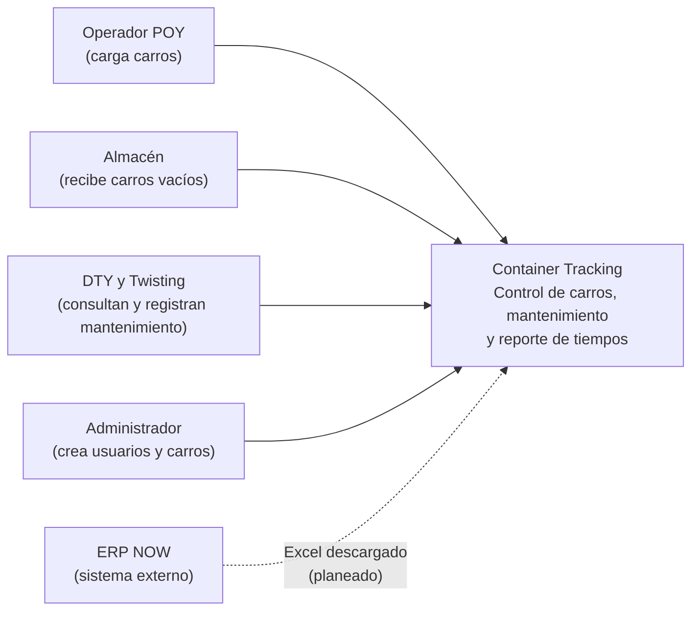
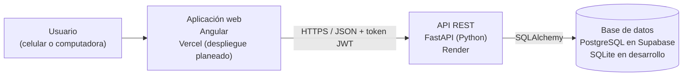
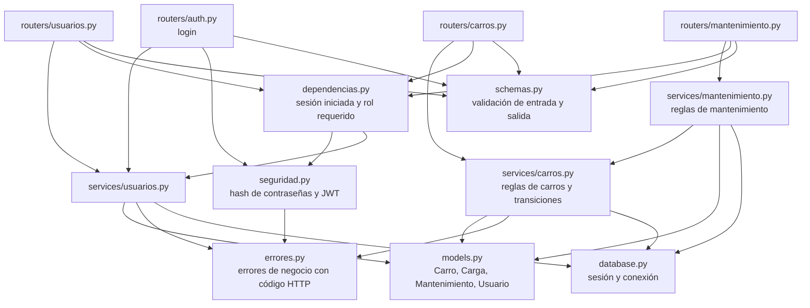

# Arquitectura (modelo C4)

Los diagramas usan Mermaid, que GitHub muestra directamente. Lo marcado como *planeado* aún no está implementado.

## Nivel 1: Contexto

Quién usa el sistema y con qué se relaciona.

El sistema es paralelo a NOW: no lo modifica ni se conecta a él en línea. La relación con NOW es un archivo Excel que el usuario sube para el reporte de tiempos.

## Nivel 2: Contenedores

Las piezas que se despliegan.

## Nivel 3: Componentes de la API

Cómo está organizado el backend (`backend/app/`).

Los routers solo manejan HTTP. Las reglas de negocio están en los servicios, que no conocen HTTP. Los errores de negocio declaran su propio código HTTP y un único manejador en `main.py` los traduce. Las decisiones detrás de esta estructura están en los [ADR](adr/).

## Decisiones registradas

- [ADR 0001: Base de datos configurable por entorno](adr/0001-base-de-datos-por-entorno.md)
- [ADR 0002: Capa de servicio y transiciones de estado atómicas](adr/0002-transiciones-atomicas-de-estado.md)
- [ADR 0003: Autenticación con JWT propio y autorización por roles](adr/0003-autenticacion-jwt-y-roles.md)
- [ADR 0004: Migraciones con Alembic y despliegue en Render, Vercel y Supabase](adr/0004-migraciones-y-despliegue.md)
- [ADR 0005: Historial de cargas como tabla propia](adr/0005-historial-de-cargas.md)
- [ADR 0006: PWA, uso sin conexión y endurecimiento del sitio publicado](adr/0006-pwa-y-endurecimiento-del-sitio.md)
- [ADR 0007: La API como única puerta a los datos, con seguridad por filas](adr/0007-acceso-a-datos-y-rls.md)

La guía paso a paso para publicar el sistema está en [DESPLIEGUE.md](DESPLIEGUE.md).

## Pendiente de incorporar

Carga del Excel de NOW con el reporte de tiempos, y el resto del frontend (carga y entrega de carros, mantenimiento, captura con lector de código de barras, PWA con funcionamiento sin conexión).
